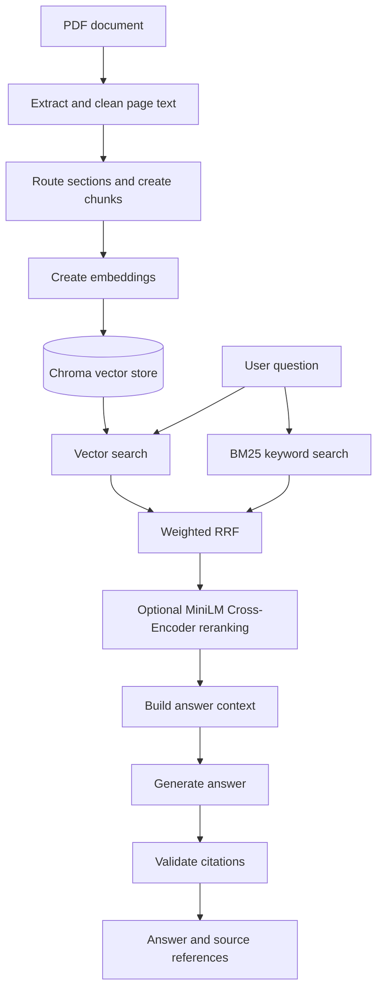

# AWS Document RAG

## Project overview

- This project answers questions about the AWS Overview PDF.
- It finds relevant PDF text and gives that text to Gemini to write an answer.
- Answers include source references to the document, page, and retrieved chunk.
- Local Sentence Transformers create embeddings by default. Gemini embeddings are optional.

## RAG workflow



## Features

- Extracts PDF pages and cleans their text.
- Routes content, navigation, and document history sections.
- Splits content into overlapping text chunks.
- Uses local `sentence-transformers/all-MiniLM-L6-v2` embeddings by default (384 dimensions).
- Supports Gemini embeddings as an optional provider.
- Stores vectors in Chroma, with separate collections for each provider and model.
- Searches with vector similarity and BM25 keyword matching.
- Combines search rankings with weighted Reciprocal Rank Fusion (RRF).
- Can rerank the top 10 hybrid candidates with a local MiniLM Cross-Encoder and pass the best five chunks to answer generation.
- Generates answers with Gemini and validates cited source chunks.
- Calculates retrieval metrics and optionally evaluates answers with Gemini.
- Does not implement query rewriting. Reranking is optional and controlled by environment settings.

## Technologies

- Python
- LangChain and PyMuPDF for PDF loading
- Sentence Transformers or Gemini for embeddings
- ChromaDB for vector storage
- BM25 for keyword retrieval
- Gemini for answer generation

## Project folders

```text
documents/                 Source AWS PDF
data/extracted_text/       Extracted and cleaned page text
data/chunks/               Content, navigation, and history chunks
data/chroma/               Persistent vector database
data/evaluation/           Evaluation dataset and result files
src/ingestion/             PDF extraction, cleanup, and section routing
src/chunking/              Text chunking
src/embeddings/            Local and Gemini embedding providers
src/vectorstore/           Chroma storage and indexing
src/retrieval/             Vector, BM25, hybrid search, RRF, and CLI
src/rag/                   Gemini prompt and answer formatting
src/evaluation/            Evaluation dataset, metrics, and pipeline
tests/                     Automated tests
```

## Installation

Run these commands in PowerShell from the project folder:

```powershell
python -m venv .venv
.venv\Scripts\Activate.ps1
python -m pip install -r requirements.txt
if (-not (Test-Path .env)) { Copy-Item .env.example .env }
```

- The final command creates `.env` only if it does not already exist.
- Local embeddings download the model on first use and cache it for later runs.
- Add a Gemini API key to `.env` to generate answers. The default chat model is `gemini-3.5-flash-lite`.
- Answer generation uses Gemini regardless of which embedding provider is selected.

## Embedding configuration

The default `.env` settings are:

```text
EMBEDDING_PROVIDER=local
EMBEDDING_MODEL=sentence-transformers/all-MiniLM-L6-v2
EMBEDDING_BATCH_SIZE=32
```

To use Gemini embeddings, set `EMBEDDING_PROVIDER=gemini` and choose the configured Gemini embedding model in `.env`.

## Optional Cross-Encoder reranking

- The production CLI can rerank fused hybrid results with `cross-encoder/ms-marco-MiniLM-L-6-v2`.
- The model scores the original question with each candidate chunk. It changes the ordering of retrieved chunks; it does not add new chunks or change the index.
- The measured comparison on the 21-question evaluation set found that hybrid RRF plus MiniLM reranking with 10 candidates preserved Recall@5 (`1.0000`) and increased MRR@5 from `0.8413` to `0.9762`. Median retrieval time rose from `15.7 ms` to `341.9 ms` on the measured CPU. These are prior experiment measurements, not a guarantee for other hardware.
- To enable the selected configuration, set these values in `.env`:

```text
RERANKER_ENABLED=true
RERANKER_MODEL=cross-encoder/ms-marco-MiniLM-L-6-v2
RERANKER_CANDIDATE_COUNT=10
RERANKER_TOP_K=5
```

- Set `RERANKER_ENABLED=false` to use the existing hybrid RRF results directly. The default in code is disabled if the setting is absent, preserving existing behavior.
- The first enabled run downloads the model if it is not cached. Subsequent questions in the same CLI process reuse the loaded model.
- See [COMMANDS.md](COMMANDS.md) for enabled, disabled, and evaluation commands.

## Prepare the documents

Run preprocessing first:

```powershell
python -m src.preprocess
```

- Extracts PDF pages and cleans the text.
- Routes sections and writes chunk files under `data/chunks/`.
- Uses 800-character chunks with 150-character overlap by default.

## Build or update the vector index

After preprocessing, index the content chunks:

```powershell
python -m src.vectorstore.index_chunks
```

- Creates embeddings and stores chunks in the matching Chroma collection.
- Unchanged chunks are skipped on later runs.
- Local and Gemini embeddings use separate collections.
- Use `--rebuild` only when you intend to regenerate vectors for the current chunks.

## Ask questions

Run the interactive CLI:

```powershell
python -m src.retrieval.cli
```

Or pass one question directly:

```powershell
python -m src.retrieval.cli --question "What is Amazon Lightsail?"
```

## Search methods

- **Dense vector search:** Finds text with a similar meaning, even when the words differ.
- **Sparse BM25 search:** Ranks text by matching query words. It runs against `data/chunks/content_chunks.json`.
- **Hybrid search:** Uses both dense and BM25 results.
- **RRF:** Weighted Reciprocal Rank Fusion combines rankings by rank position. This avoids comparing scores from different search methods directly. The default constant is 60 and each search has a default weight of 1.0.
- **Reranking:** Optional MiniLM Cross-Encoder reranks hybrid candidates after RRF. It adds local CPU latency and cannot recover a chunk absent from the candidate set.
- **Query rewriting:** Not implemented.

## Evaluation

### Dataset

- Default file: `data/evaluation/aws_overview_eval.json`.
- Contains 21 questions, reference answers, and expected relevant pages and chunk IDs.
- Retrieval scoring uses expected chunk IDs. Expected pages appear in reports for inspection.

### Retrieval metrics

- **Precision@K:** Portion of the top K results labeled relevant.
- **Recall@K:** Portion of all labeled relevant chunks found in the top K.
- **MRR:** Rank of the first relevant result, expressed as its reciprocal.
- **Hit rate@K:** Whether at least one relevant chunk appears in the top K.

### Optional answer evaluation

- Gemini can estimate answer relevance, faithfulness to retrieved context, context relevance, and correctness against the reference answer.
- These LLM scores are estimates and may be inaccurate.
- Results are written as JSON under `data/evaluation/`.

See [COMMANDS.md](COMMANDS.md) for evaluation, tests, and all supported PowerShell commands.

## Example

**Question:** What is Amazon Lightsail?

**Answer:** Amazon Lightsail is a simple way to launch and manage a virtual private server on AWS. Plans include a virtual machine, SSD storage, data transfer, DNS management, and a static IP for a predictable price.

**Source References:**

- Document: `aws-overview.pdf`
- Page: 47
- Chunk ID: `page-0047-chunk-0002`

## Limitations

- The project is set up for one AWS PDF.
- Section routing depends on the PDF's headings and layout.
- A source reference shows which retrieved text was cited; it does not guarantee every answer statement is correct.
- Misspelled or vague questions can retrieve poor context. There is no spelling correction or query rewriting.
- The reranker model may require a first-run download and adds about 0.33 seconds median CPU latency in the saved 10-candidate experiment.
- A Gemini API key is required for answers and optional Gemini answer evaluation.
- The CLI checks for a Gemini API key at startup, including retrieval-only evaluation.

## Troubleshooting

- If Chroma has no vectors, run preprocessing and then indexing.
- If the wrong embedding collection is used, check `EMBEDDING_PROVIDER` and `EMBEDDING_MODEL` in `.env`.
- If local model loading fails, check network access for the first download or confirm that the model is cached locally.
- If an answer seems incorrect, inspect the search rankings with the CLI's `--compare` option.
- See [COMMANDS.md](COMMANDS.md) for command options and examples.

## Possible next steps

- Add typo correction or query rewriting.
- Add a reranker and measure its effect on retrieval.
- Expand evaluation coverage and review answer quality with human reviewers.
- Support more documents and configurable section routing.
